# World Billionaires SQL Data Analysis

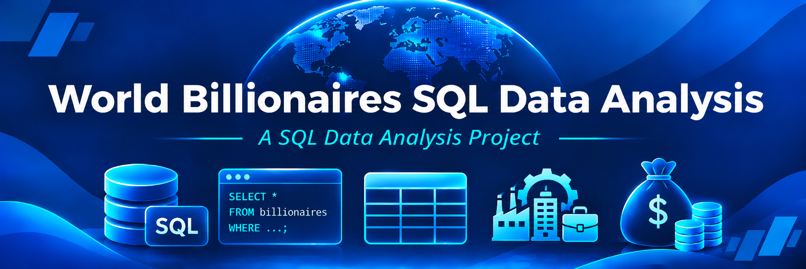

## Project Overview

This SQL data analysis project explores the **world's top 200 billionaires**, focusing on their net worth, age, rankings, countries, and industries. The project aims to better understand how wealth is distributed among the world's richest people by using **SQL queries** to explore the dataset, compare results, answer different questions, and find useful insights. A total of **20 questions** are answered in this project. These questions cover different SQL concepts, from basic data exploration and filtering to grouping, calculations, and nested queries.

## Dataset and Tools

- **Dataset:** [Top 200 Richest World's Billionaires Dataset — Kaggle](https://www.kaggle.com/datasets/mayankanand2701/top-200-richest-worlds-billionaires-dataset?resource=download)
- **SQL Environment:** [SQLite Online](https://sqliteonline.com/)
- **Language:** SQL (SQLite)

## Dataset Columns

The dataset contains information about the world's top 200 billionaires, with seven columns describing each person.

| Column | Description |
|---|---|
| `serial_number` | A sequential number assigned to each billionaire in the dataset |
| `rank` | The billionaire's global ranking based on net worth, according to Forbes |
| `name` | The name of the billionaire |
| `age` | The age of the billionaire in years |
| `country` | The country the billionaire belongs to |
| `networth_billion` | The billionaire's net worth in billions of US dollars |
| `industry` | The industry or business sector associated with the billionaire's wealth |

## SQL Concepts Used

The project covers different SQL concepts and functions, including:

- **Data Retrieval:** `SELECT`, `DISTINCT`
- **Data Filtering:** `WHERE`, `AND`, `IN`, `LIKE`, `BETWEEN`
- **Data Sorting:** `ORDER BY`, `ASC`, `DESC`, `LIMIT`
- **Aggregate Functions:** `COUNT()`, `SUM()`, `AVG()`, `MIN()`, `MAX()`
- **Data Grouping:** `GROUP BY`, `HAVING`
- **Calculations:** Arithmetic operations, percentages, `ROUND()`
- **Advanced Queries:** Subqueries (Nested Queries)

## Project Files

- **`README.md`:** Contains the project overview, questions, SQL queries, and result screenshots.
- **`Final Project.sql`:** Contains all SQL queries used in the project.
- **`Top 200 Richest Person in the World.csv`:** The dataset used for the analysis.
- **`images/`:** Contains the project introductory image and screenshots of SQL query results.

## How to Run the Queries

1. Open [SQLite Online](https://sqliteonline.com/) and select SQLite.
2. Import the CSV dataset.
3. Open the `Final Project.sql` file.
4. Run the SQL queries individually to view and explore the results.

---

## SQL Questions, Queries, and Results

***Note:*** Some screenshots show only part of the results because the query output contains too many rows to fit in one screenshot. Multiple screenshots are included for some questions where needed.

### 1. What does the entire dataset look like?

```sql
SELECT *
FROM Top200RichestPersonintheWorld;
```

**Result**

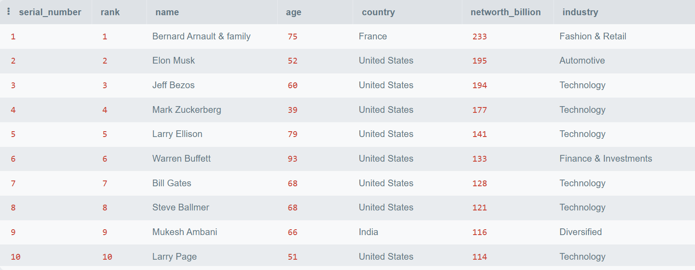

<p align="center">
  •<br>
  •<br>
  •<br>
</p>

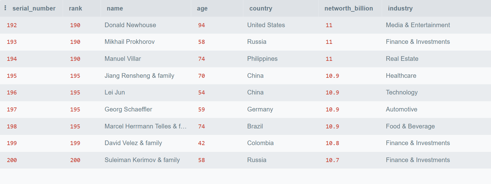

---

### 2. Retrieve the 20 richest billionaires.

```sql
SELECT *
FROM Top200RichestPersonintheWorld
ORDER BY networth_billion DESC
LIMIT 20;
```

**Result**


---

### 3. Identify the five youngest billionaires.

```sql
SELECT *
FROM Top200RichestPersonintheWorld
ORDER BY age ASC
LIMIT 5;
```

**Result**

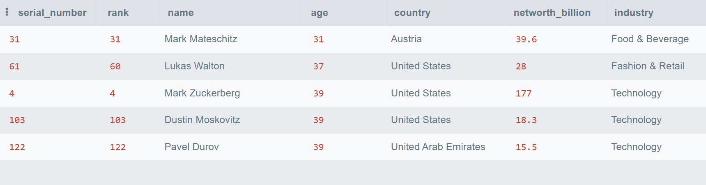

---

### 4. Calculate the average age and average net worth.

```sql
SELECT AVG(age) AS average_age,
       AVG(networth_billion) AS average_networth
FROM Top200RichestPersonintheWorld;
```

**Result**


---

### 5. Identify the five most represented countries.

```sql
SELECT country,
       COUNT(*) AS billionaire_count
FROM Top200RichestPersonintheWorld
GROUP BY country
ORDER BY billionaire_count DESC
LIMIT 5;
```

**Result**

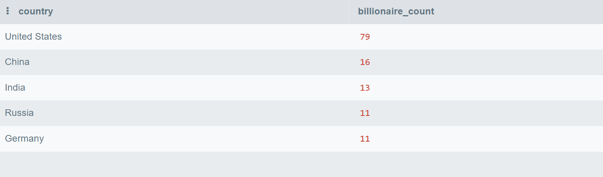

---

### 6. Calculate the combined net worth of billionaires from each country.

```sql
SELECT country,
       ROUND(SUM(networth_billion), 2) AS combined_networth_billion
FROM Top200RichestPersonintheWorld
GROUP BY country
ORDER BY SUM(networth_billion) DESC;
```

**Result**

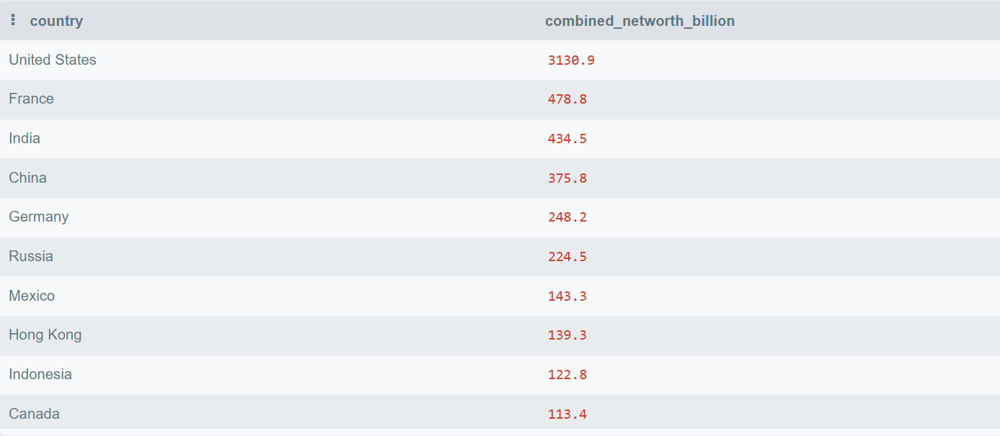

<p align="center">
  •<br>
  •<br>
  •<br>
</p>

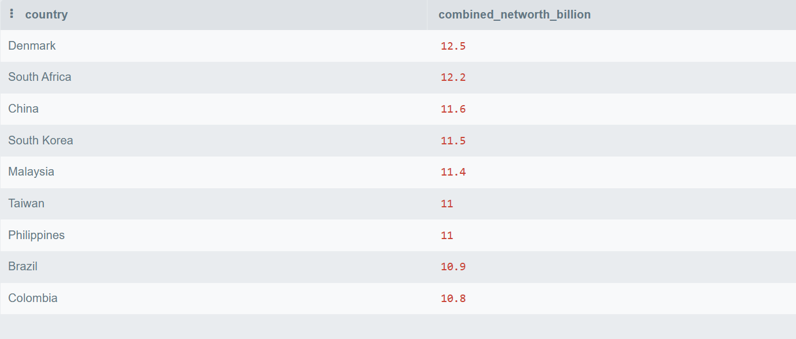

---

### 7. Identify the five industries with the highest number of billionaires.

```sql
SELECT industry,
       COUNT(*) AS billionaire_count
FROM Top200RichestPersonintheWorld
GROUP BY industry
ORDER BY billionaire_count DESC
LIMIT 5;
```

**Result**

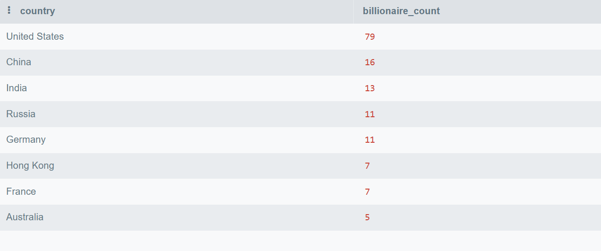

---

### 8. Find countries with at least five billionaires.

```sql
SELECT country,
       COUNT(*) AS billionaire_count
FROM Top200RichestPersonintheWorld
GROUP BY country
HAVING billionaire_count >= 5
ORDER BY billionaire_count DESC;
```

**Result**


---

### 9. Calculate the total wealth of billionaires younger than 50.

```sql
SELECT SUM(networth_billion) AS total_wealth_of_billionaires_younger_than_50
FROM Top200RichestPersonintheWorld
WHERE age < 50;
```

**Result**

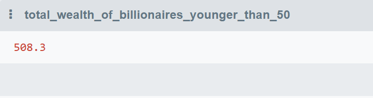

---

### 10. Identify billionaires whose net worth exceeds the overall average net worth.

```sql
SELECT name,
       networth_billion
FROM Top200RichestPersonintheWorld
WHERE networth_billion > 
      (
          SELECT AVG(networth_billion)
          FROM Top200RichestPersonintheWorld
      )
ORDER BY networth_billion DESC;
```

**Result**

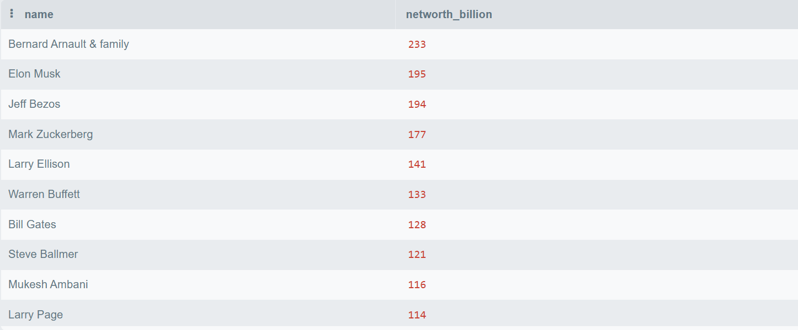

<p align="center">
  •<br>
  •<br>
  •<br>
</p>

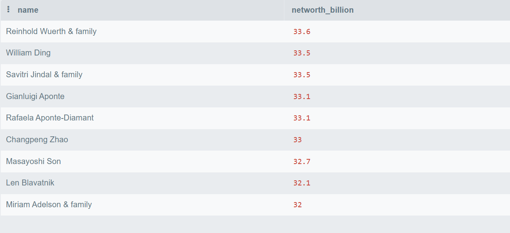

---

### 11. Identify the industry with the highest average net worth.

```sql
SELECT industry,
       AVG(networth_billion) AS industry_average_networth
FROM Top200RichestPersonintheWorld
GROUP BY industry
ORDER BY industry_average_networth DESC
LIMIT 1;
```

**Result**


---

### 12. Who are the billionaires whose names begin with the letter A?

```sql
SELECT rank,
       name,
       age,
       networth_billion,
       country,
       industry
FROM Top200RichestPersonintheWorld
WHERE name LIKE 'A%';
```

**Result**

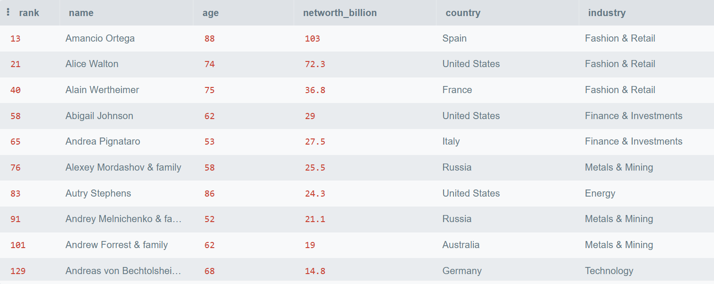

---

### 13. Who are the billionaires aged above 60 with a net worth greater than $50 billion?

```sql
SELECT rank,
       name,
       age,
       networth_billion,
       country,
       industry
FROM Top200RichestPersonintheWorld
WHERE age > 60
AND networth_billion > 50;
```

**Result**

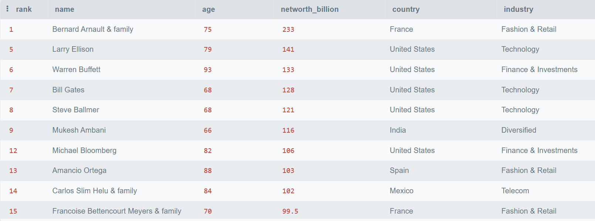

---

### 14. Which billionaires belong to industries with more than 10 representatives?

```sql
SELECT rank,
       name,
       age,
       networth_billion,
       country,
       industry
FROM Top200RichestPersonintheWorld
WHERE industry IN (
    SELECT industry
    FROM Top200RichestPersonintheWorld
    GROUP BY industry
    HAVING COUNT(*) > 10
)
ORDER BY industry, networth_billion DESC;
```

**Result**

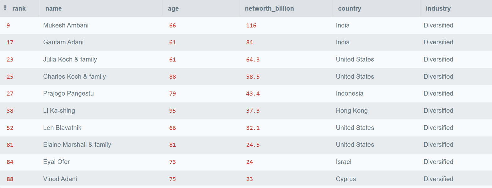

---

### 15. What is the difference between the richest and poorest billionaire in the dataset?

```sql
SELECT MAX(networth_billion) AS max_networth_billion,
       MIN(networth_billion) AS min_networth_billion,
       MAX(networth_billion) - MIN(networth_billion) AS networth_billion_difference
FROM Top200RichestPersonintheWorld;
```

**Result**

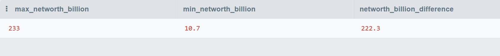

---

### 16. What percentage of the dataset is made up of billionaires younger than 50?

```sql
SELECT COUNT(*) * 100.0 / (
    SELECT COUNT(*)
    FROM Top200RichestPersonintheWorld
) AS percentage_of_billionaires_younger_than_50
FROM Top200RichestPersonintheWorld
WHERE age < 50;
```

**Result**


---

### 17. Which country has the highest number of billionaires below age 40?

```sql
SELECT country,
       COUNT(*) AS number_of_billionaires
FROM Top200RichestPersonintheWorld
WHERE age < 40
GROUP BY country
ORDER BY number_of_billionaires DESC
LIMIT 1;
```

**Result**


---

### 18. Which industry has the highest average billionaire age?

```sql
SELECT industry,
       AVG(age) AS average_age
FROM Top200RichestPersonintheWorld
GROUP BY industry
ORDER BY average_age DESC
LIMIT 1;
```

**Result**


---

### 19. Who has a net worth between $50 billion and $100 billion?

```sql
SELECT rank,
       name,
       age,
       networth_billion,
       country,
       industry
FROM Top200RichestPersonintheWorld
WHERE networth_billion BETWEEN 50 AND 100;
```

**Result**

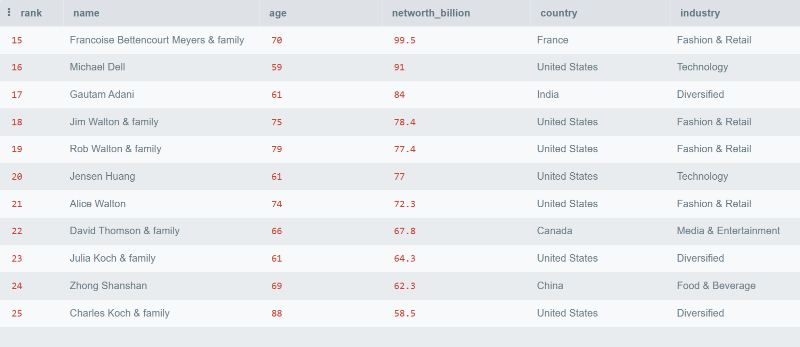

---

### 20. Which industry contributes the most to the combined wealth of the top 200?

```sql
SELECT industry,
       SUM(networth_billion) AS total_networth_billion
FROM Top200RichestPersonintheWorld
GROUP BY industry
ORDER BY total_networth_billion DESC
LIMIT 1;
```

**Result**


---

## Conclusion

This project shows how SQL can be used to explore and analyze data and answer different questions about the world's top 200 billionaires.

Through the 20 SQL questions, the analysis covers wealth distribution, billionaire rankings, age groups, and comparisons between countries and industries. Different SQL functions and techniques are used to organize the data, perform calculations, filter results, and extract useful insights.

Overall, the project provides practical experience in using SQL for data analysis and shows how raw data can be turned into meaningful information.

**Note:** The results are based on the dataset used in this project and do not represent live billionaire rankings.

## Data Source

[Top 200 Richest World's Billionaires Dataset — Kaggle](https://www.kaggle.com/datasets/mayankanand2701/top-200-richest-worlds-billionaires-dataset?resource=download)
